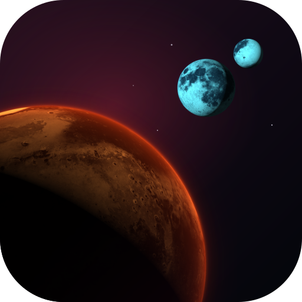

# Arrakis  [](#license) [](https://www.buymeacoffee.com/bkahlert)

Animated backgrounds inspired by Dune's deserts and planetary orbits. Each background ships as a WebGL runtime, a native web component, an animated SVG, and a still SVG.

## Backgrounds

| Background | npm package | Preview | Package guide | Comparison page |
| --- | --- | --- | --- | --- |
| Arrakis Desert | `@bkahlert/arrakis-desert` | [](packages/arrakis-desert/svg/arrakis-desert.svg) | [README](packages/arrakis-desert/README.md) | [Compare formats](packages/arrakis-desert/index.html) |
| Arrakis Desert (1984) | `@bkahlert/arrakis-desert-1984` | [](packages/arrakis-desert-1984/svg/arrakis-desert-1984.svg) | [README](packages/arrakis-desert-1984/README.md) | [Compare formats](packages/arrakis-desert-1984/index.html) |
| Arrakis Orbit | `@bkahlert/arrakis-orbit` | [](packages/arrakis-orbit/svg/arrakis-orbit.svg) | [README](packages/arrakis-orbit/README.md) | [Compare formats](packages/arrakis-orbit/index.html) |
| Arrakis Orbit (1984) | `@bkahlert/arrakis-orbit-1984` | [](packages/arrakis-orbit-1984/svg/arrakis-orbit-1984.svg) | [README](packages/arrakis-orbit-1984/README.md) | [Compare formats](packages/arrakis-orbit-1984/index.html) |

The comparison pages show the live WebGL, component, and SVG variants. The package guides explain integration, motion controls, fallbacks, and each background's rendering details.

## Development

Node.js 22 or newer is required. Build a background from the repository root:

Regenerate the repository logo with `node tools/build-logo.mjs`.

```shell
npm install
npm run build --workspace=packages/arrakis-desert
npm test
```

Run `npm run build --workspaces --if-present` to build every background.
`npm test` runs the test suites for all four background workspaces.

## Credits and licenses

Original software is licensed under MIT. Texture assets and finished visual outputs that incorporate them, including the repository logo, are licensed under CC BY 4.0. The logo reuses the Arrakis Orbit (1984) sphere renders; source and modification credits are in [that package's credits](packages/arrakis-orbit-1984/CREDITS.txt). Each package includes its own license terms and texture credits.
